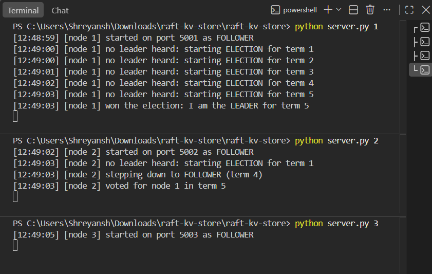
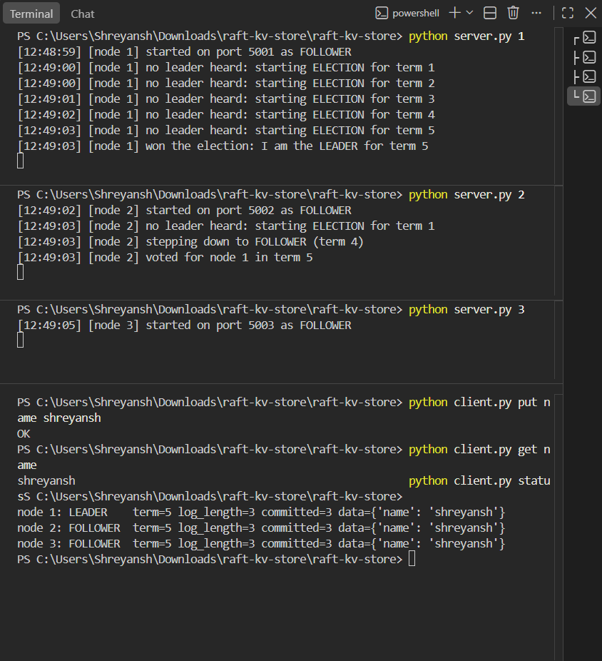
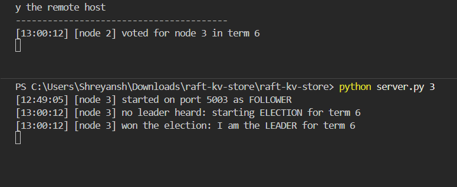
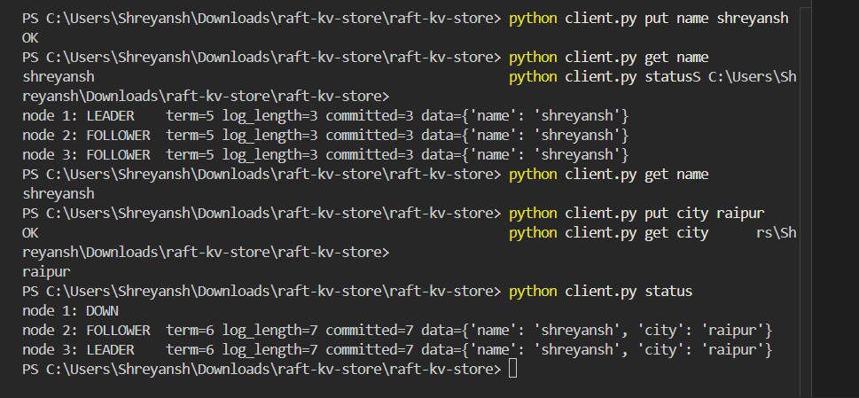
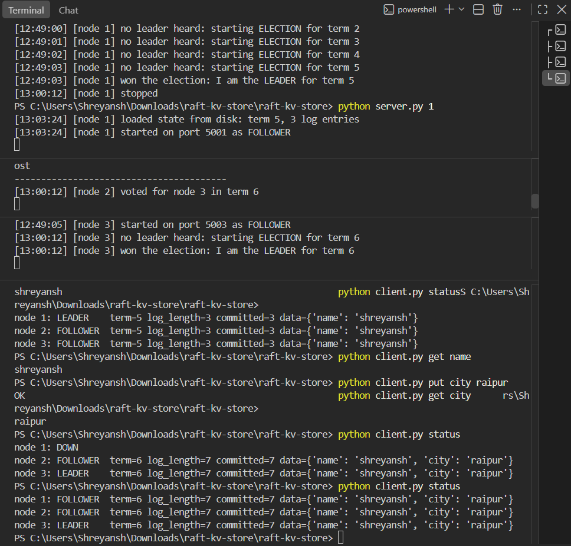
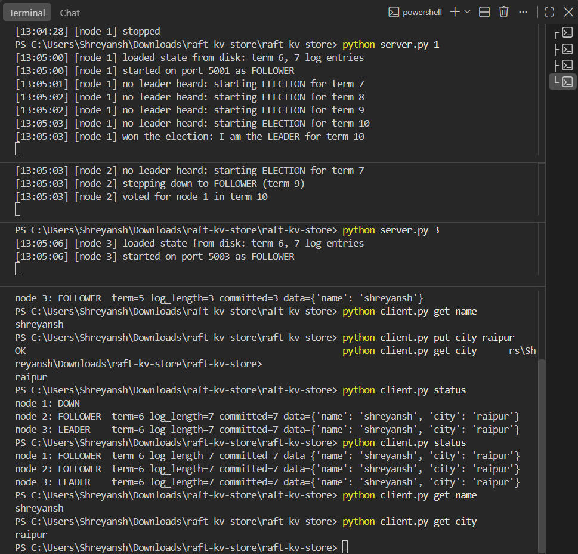
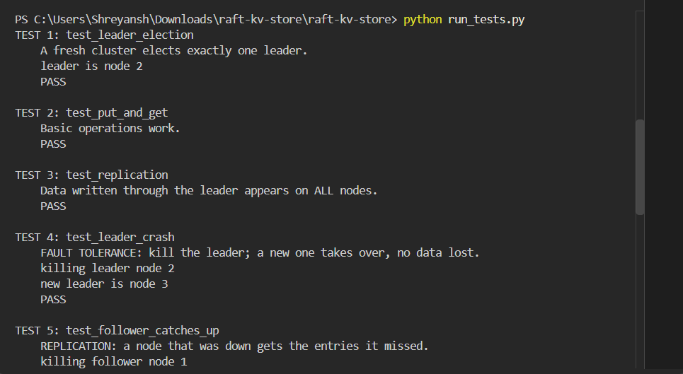
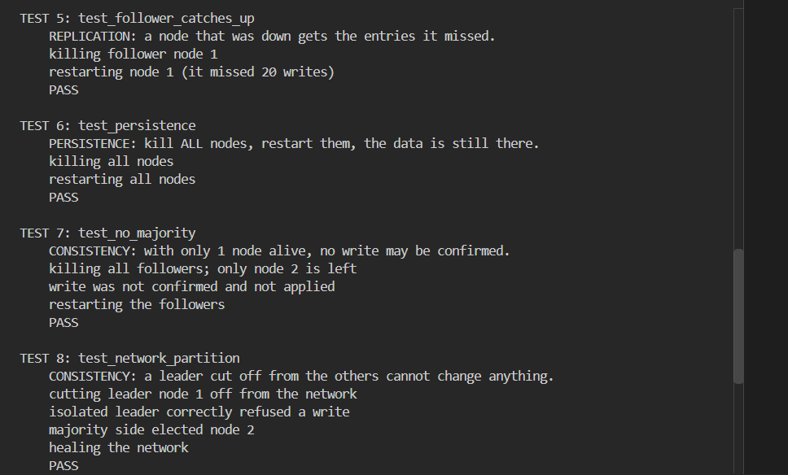

# A Fault-Tolerant, Replicated and Consistent Key-Value Store using Raft in Python

**Distributed Systems Assignment 1**

*Name: Shreyansh Shrivastava · Roll No: 23115089 · Course: Distributed Systems · NIT Raipur*

A small distributed database that stores `key -> value` pairs on **3 servers** (the number is configurable).
It keeps working, and never loses confirmed data, when a server crashes.

| Requirement     | How this project does it                                              |
|-----------------|-----------------------------------------------------------------------|
| Fault tolerance | Raft leader election: if the leader dies, a new one is elected in about 1 second. Works as long as 2 of 3 nodes are alive. |
| Replication     | Raft log replication: every command is copied to all nodes; a node that was down catches up automatically. |
| Consistency     | A write is confirmed only after a majority stores it; reads go through the log too (linearizable); duplicate requests are executed once. |
| Persistence     | Each node saves its term, vote and log to disk and reloads them after a restart. |

Only the Python standard library is used. Nothing to install except Python 3.8+.

## Files

| File            | What it does                                                    |
|-----------------|-----------------------------------------------------------------|
| `config.py`     | Addresses of the 3 nodes and the timing settings                |
| `rpc.py`        | How nodes send messages to each other (one JSON line over TCP)  |
| `raft.py`       | The Raft algorithm: election, replication, persistence          |
| `kv_store.py`   | The database itself (a dictionary) with duplicate detection     |
| `server.py`     | Runs one node                                                   |
| `client.py`     | Command-line client: put / get / append / delete / status       |
| `run_tests.py`  | 10 automatic tests that crash nodes and check correctness       |
| `test_results.txt` | Output of a test run                                         |

Suggested reading order: `config.py`, `rpc.py`, `kv_store.py`, `raft.py`, `server.py`, `client.py`.

## How it works

1. **One leader.** Every node starts as a *follower*. The leader sends a heartbeat
   every 0.1 s. A follower that hears nothing for 0.5-1.0 s (random) becomes a
   *candidate*, increases the *term* number and asks for votes. A node votes once
   per term. Whoever gets 2 of 3 votes is the leader.
2. **One log.** A client sends a command to the leader. The leader adds it to its
   log and sends it to the followers. When 2 of 3 nodes have it, it is *committed*,
   executed on the dictionary, and the client gets its answer.
3. **Why majority?** Any two majorities share at least one node, so a new leader
   always knows every committed command. A node only votes for a candidate whose
   log is at least as up to date as its own.
4. **Crash recovery.** Term, vote and log are written to `data/node_N.json` before
   any reply is sent. After a restart the node reloads them and rebuilds the
   dictionary by replaying the log.
5. **Exactly once.** Every request carries a client id and a request number.
   If a retry puts the same request in the log twice, it is executed only once.

## How to run

Open the project folder in VS Code and open **four** terminals (if 3 servers are used)
(Terminal > New Terminal, then the split button).
On Mac/Linux type `python3` instead of `python`.

Terminals 1, 2 and 3 - one node each:

```
python server.py 1
python server.py 2
python server.py 3
```

Terminal 4 - the client:

```
python client.py put name shreyansh
python client.py get name
python client.py status
```

### Demo: fault tolerance

1. `python client.py status` shows which node is the LEADER.
2. Click that node's terminal and press **Ctrl+C** (this is the "crash").
3. Watch another terminal print `won the election: I am the LEADER`.
4. `python client.py get name` still prints `shreyansh`.
5. `python client.py put city raipur` still works with 2 of 3 nodes.
6. Start the crashed node again (`python server.py N`). It prints
   `loaded state from disk` and `python client.py status` shows it has
   caught up with `city`.

To start again from an empty database, stop all nodes and delete the `data` folder.

### Screenshots of the demo

**1. Cluster started: three nodes, one elected leader**



**2. Put, get and status: the same data on every node (replication)**



**3. Leader crashed with Ctrl+C: another node wins a new election (fault tolerance)**



**4. Reads and writes still work with one node down**



**5. Crashed node restarted: it loads its state from disk and catches up**



**6. All nodes stopped and restarted: the data survives (persistence)**



## How to test

Stop any nodes you started by hand first (the tests use the same ports), then:

```
python run_tests.py
```

| #  | Test                     | What it proves                                               |
|----|--------------------------|--------------------------------------------------------------|
| 1  | leader election          | exactly one leader is elected and it stays stable            |
| 2  | put and get              | put / get / append / delete work                             |
| 3  | replication              | all 3 nodes hold the same data                               |
| 4  | leader crash             | new leader elected, no data lost, writes continue            |
| 5  | follower catches up      | a node that missed 20 writes gets all of them                |
| 6  | persistence              | all nodes killed and restarted, data still there             |
| 7  | no majority              | with 1 of 3 nodes alive, no write is confirmed or applied    |
| 8  | network partition        | an isolated leader cannot write; after healing all nodes agree |
| 9  | duplicate request        | the same request sent twice is executed once                 |
| 10 | concurrent clients       | 50 simultaneous writes, each applied exactly once, in order  |

Expected last lines (about 20 seconds):

```
==================================================
RESULT: 10 of 10 tests passed (20 seconds)
==================================================
```

The full output of one run is in `test_results.txt`.

### Screenshots of the test results

Tests 1 to 10 running in the VS Code terminal, ending with `10 of 10 tests passed`.

**Part 1**



**Part 2**



**Part 3**


## Changing the number of servers (for example 3 to 5)

The cluster size is not hard-coded. Raft works out the majority from the list
of nodes in `config.py`, so adding servers needs no change to the algorithm.

| Servers | Majority needed | Crashes survived |
|---------|-----------------|------------------|
| 3       | 2               | 1                |
| 5       | 3               | 2                |
| 7       | 4               | 3                |

Use an odd number. An even number adds cost without adding safety
(4 servers need 3 for a majority, so they still survive only 1 crash).

Steps to go from 3 to 5 servers:

1. **Stop every running node** (Ctrl+C in each server terminal).
2. **Delete the `data` folder.** The old saved state belongs to the 3-node cluster.
3. **Edit `config.py`** and add one line per new node, each with its own unused port:

   ```python
   NODES = {
       1: ("127.0.0.1", 5001),
       2: ("127.0.0.1", 5002),
       3: ("127.0.0.1", 5003),
       4: ("127.0.0.1", 5004),
       5: ("127.0.0.1", 5005),
   }
   ```

4. **Start one terminal per node:**

   ```
   python server.py 1
   python server.py 2
   python server.py 3
   python server.py 4
   python server.py 5
   ```

5. **Use the client as before.** `python client.py status` now lists 5 nodes.
6. **Try it:** stop any 2 nodes and `put` / `get` still work. Stop a 3rd and
   writes stop being confirmed, because 2 of 5 is not a majority.
7. **Run the tests** (after stopping the nodes): `python run_tests.py`.
   The tests read `config.py`, so they automatically use all 5 nodes.

All nodes must use the same `config.py`. Change it only while the whole
cluster is stopped; adding a node to a running cluster is not supported.


## Limitations

- No log compaction : the log grows forever and is rewritten to disk on every change.
- The cluster size is set in `config.py` and cannot change while the cluster is running.
- All nodes run on one computer (different ports). To use several machines, change the addresses in `config.py`.

## References

- Ongaro and Ousterhout, "In Search of an Understandable Consensus Algorithm" (the Raft paper), Figure 2.
- MIT 6.824 / 6.5840 Distributed Systems, Raft and KV-Raft labs.
